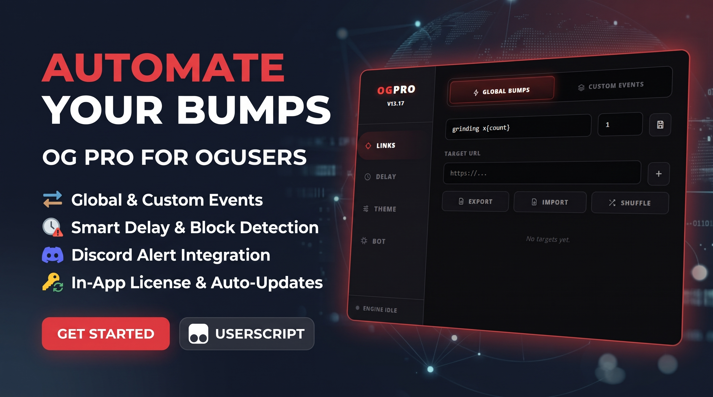

Userscript (Tampermonkey / Violentmonkey) that automatically posts "bump" messages to threads on `oguser.com`. It works in two modes: a **global cycle** (BUMPS) and **custom event folders** (EVENTOS). It includes a floating red panel, license gating, Discord webhook notifications, 404 link removal, import/export, shuffle, removal of page elements, and an in-panel updater.

- **Name:** OGU BUMPS
- **Version:** 13.17
- **Match:** `https://oguser.com/*`
- **Top frame only:** the script exits when it runs inside an iframe (`window.top !== window.self`). Bump pages are loaded in hidden iframes by the script itself, so the UI never appears there.
- **Storage:** all state uses `GM_setValue` / `GM_getValue` with keys prefixed `OG_PRO_`.
- **Grants:** `GM_setValue`, `GM_getValue`, `GM_xmlhttpRequest`, `GM_info`.
- **Allowed `@connect` hosts:** `discord.com`, `discordapp.com`, `raw.githubusercontent.com`.
- **Icons:** inline SVG (no external CDN).

---

## Table of contents

1. [Architecture](#architecture)
2. [Icons](#icons)
3. [Auth](#auth)
4. [State](#state)
5. [i18n](#i18n)
6. [Utils](#utils)
7. [Updater](#updater)
8. [Removals](#removals)
9. [Transfer (import / export)](#transfer-import--export)
10. [Delay (timing)](#delay-timing)
11. [UI](#ui)
12. [Events](#events)
13. [Bot](#bot)
14. [Main loop](#main-loop)
15. [Data model](#data-model)
16. [Lifecycle](#lifecycle)
17. [Known limitations](#known-limitations)

---

## Architecture

A single IIFE. Modules are defined in this order and the script starts at the bottom with `Auth.check()`.

| Module | Responsibility |
|---|---|
| `ICONS` / `Icon` | Inline SVG paths and the helper that wraps them |
| `Auth` | License screen and key validation against a GitHub JSON file |
| `State` | In-memory state and persistence |
| `i18n` | Strings in English, Spanish and Russian |
| `Utils` | Time parsing, URL validation, escaping, file-name slugs, shuffle |
| `Updater` | Polls GitHub for a newer `@version` every 2 minutes |
| `Removals` | Hides page elements through a `MutationObserver` |
| `Transfer` | JSON import and export of link lists |
| `Delay` | Timing editor for cycles and delays between links |
| `UI` | Renders the floating button, the panel and every tab |
| `Events` | Delegated click and input handling for the panel |
| `Bot` | Injection queue, hidden iframes, 404 removal, webhooks, award scanner |
| `buildCycle`, `StartLoop` | Builds cycle queues once per second |
| `InitApp` | Boots the app after authentication |

---

## Icons

### `ICONS` (object)
Map from icon name to SVG path markup (`skull`, `discord`, `bolt`, `folder`, `trash`, `shuffle`, and so on). Each value is the inner content of a 24×24 SVG.

### `Icon(name, cls = '')`
Returns an `<svg class="og-ico ...">` string built from `ICONS[name]`. If the name does not exist, the SVG is empty.

---

## Auth

Access is gated by a license key. Valid keys are a JSON array stored in a public GitHub file, so keys can be revoked remotely.

### `Auth.URL`
Raw URL of the key list (`ogu-bumper` repository, `key.json`).

### `Auth.GET_KEY_URL`
Discord invite shown in the "Get Key" button.

### `Auth.showScreen()`
Creates the full-screen license overlay with its own CSS scope (`#ogpro-auth-container`). It contains the logo, a key input (`#ogp-key`), a "Verify License" button (`#ogp-btn`), a "Get Key" link, and a status line (`#ogp-msg`).

Local helpers inside the function:
- `setMsg(text, ok)` shows a status message, green when `ok` is true.
- `shakeInput()` replays the error animation on the input.
- `setLoading(on)` toggles the spinner and the button label.

`verify()` runs on click or Enter:
- Empty input: shakes the field and shows "Introduce una key".
- Otherwise it downloads `Auth.URL`. If the key is in the array, it saves it to `OG_PRO_AUTH`, fades out the overlay and calls `InitApp()`. If not, it shows "Invalid or expired key." Parse errors show "Error connecting to server." Network errors show "Network Error."

### `Auth.check()`
- If `OG_PRO_AUTH` exists, it calls `InitApp()` immediately and re-validates the key in the background. If the key has been removed from the list, it clears `OG_PRO_AUTH` and reloads the page.
- Otherwise it calls `showScreen()`.

---

## State

A single object with runtime and persisted values.

| Field | Default | Purpose |
|---|---|---|
| `count` | `1` | Global counter for `{count}` in BUMPS messages |
| `bumpMsg` | `'grinding x{count}'` | BUMPS message template |
| `awardNotifierActive` | `false` | Award scanner on/off |
| `lastCheckedAwardTime` | `Date.now()` | Last award scan |
| `currentLang` | `'en'` | `en`, `es` or `ru` |
| `theme` | dark red palette | `bg`, `sidebar`, `stroke`, `accent`, `text` |
| `cfg` | see below | Timing values and webhook URL |
| `data` | see [Data model](#data-model) | Bumps, events, switches, schedules, completions |
| `shuffle` | `{ bumps: false, events: {} }` | Shuffle flags |
| `removals` | `{ bats: false, spider: false }` | Removal toggles |
| `queue` | `[]` | Pending injections `{ type, url, name, folderId? }` |
| `isProcessing` | `false` | True while an injection or the delay after it is in progress |
| `delayEndTime` | `0` | Epoch ms when the current delay ends |
| `botStatusMsg` | `'System IDLE. Ready to inject.'` | Text in the Bot tab status box |
| `currentTab` / `currentTabLinks` | `'links'` / `'bumps'` | Active tab and sub-tab |
| `isPanelOpen` | `false` | Panel visibility |
| `activeIframe` | `null` | Hidden iframe currently being processed |
| `updateAvailable` / `updateDismissed` | `null` / `false` | Updater state |

`cfg` defaults: `bumpCycle: '60m'`, `bumpMin: '30s'`, `bumpMax: '60s'`, `eventCycle: '60m'`, `eventMin: '30s'`, `eventMax: '60s'`, `webhook: ''`.

### `State.load()`
Reads every `OG_PRO_*` key. Object values are merged over their defaults with `Object.assign`.

### `State.save()`
Writes every persisted field with `GM_setValue`.

### `State.isRunning()`
`true` if the global BUMPS switch or any event folder is on.

### `State.anyEventActive()`
`true` if at least one event folder is on. Used to prevent BUMPS and events from running together.

---

## i18n

### `i18n.dict`
Three dictionaries (`en`, `es`, `ru`) with the same keys: tab names, labels, warnings, import/export messages and status text.

### `i18n.t(key)`
Returns the string for the current language, falls back to English, then to the key itself.

---

## Utils

### `Utils.parseTimeToMs(str)`
Converts `"30s"`, `"5m"`, `"2h"` to milliseconds. A bare number counts as minutes. Empty or invalid input returns 60000.

### `Utils.msToStr(ms)`
Formats a duration in whole minutes (`"12m"`), or in hours above 60 minutes (`"2h"`).

### `Utils.isValidUrl(s)`
`true` only for `http:` and `https:` URLs.

### `Utils.escape(s)`
Escapes `& < > " '` for safe HTML insertion.

### `Utils.safeName(s)`
Turns a string into a file-name slug. Returns `'folder'` if nothing usable remains.

### `Utils.shuffleArray(arr)`
Returns a Fisher-Yates shuffled copy of `arr`.

---

## Updater

Checks whether a newer version exists.

### `Updater.RAW_URL`
Raw URL of the script used for the version check and for the install button (`og-pro` repository, `ogpro.user.js`). See [Known limitations](#known-limitations).

### `Updater.INTERVAL_MS`
Two minutes.

### `Updater.current()`
Returns `GM_info.script.version`, or `'0'` if unavailable.

### `Updater.isNewer(remote, local)`
Compares dotted versions numerically part by part.

### `Updater.check()`
Requests `RAW_URL` with a cache-busting query and reads `@version` from the response. If it is newer, it stores it in `State.updateAvailable` and re-renders so the update bar appears. If the remote version is no longer newer, the bar is removed.

### `Updater.install()`
Opens `RAW_URL` in a new tab so Tampermonkey can install it.

### `Updater.start()`
Runs `check()` immediately, every 2 minutes, when the tab becomes visible, and when the window gains focus.

---

## Removals

Hides page elements by removing them from the DOM.

### `Removals.DEFS`
- `bats`: `` elements whose `src` starts with a fixed base64 GIF prefix.
- `spider`: elements matching `#spider-web-corners`.

### `Removals.matches(node, d)`
Checks whether one element matches definition `d`.

### `Removals.handleNode(node)`
Removes every enabled match in `node` and its descendants.

### `Removals.toggle(id)`
Flips the flag, saves, and applies it immediately when enabling.

### `Removals.start()`
Applies the current rules to the whole document, then starts a `MutationObserver` that watches new nodes and `src` changes.

---

## Transfer (import / export)

Save and load link lists as JSON. Works for BUMPS and for each event folder.

### `Transfer.input` / `Transfer.initInput()`
Creates a hidden `<input type="file">` (`.json` only) and wires its `change` event to `handleFile`.

### `Transfer.pending`
`{ type, fid }` describing where an upcoming import should go.

### `Transfer.getList(type, fid)`
Returns the array of links for BUMPS or for a folder, or `null` if the folder does not exist.

### `Transfer.getName(type, fid)`
Returns `'bumps'` or the slugged folder name.

### `Transfer.exportList(type, fid)`
Downloads `og-pro-<name>.json` containing `{ app, type, name, exportedAt, links }`. Shows an alert when the list is empty.

### `Transfer.openImport(type, fid)`
Stores the target and opens the file picker.

### `Transfer.handleFile(file)`
Reads the file. Accepts a plain array of URLs or an object with a `links` array. Trims each entry, validates it, skips duplicates (existing or repeated in the file), appends the new ones, saves, and shows a summary toast.

---

## Delay (timing)

Timing editor for both groups (BUMPS and EVENTS).

- **Cycle** (`bumpCycle` / `eventCycle`): how often the whole list is queued again.
- **Smooth min / max** (`bumpMin`, `bumpMax`, `eventMin`, `eventMax`): random delay between two consecutive links.

### `Delay.KEYS`
The six keys in display order.

### `Delay.UNITS`
Maximum value per unit: `s` 600, `m` 240, `h` 24.

### `Delay.PRESETS`
Cycle: `15m, 30m, 1h, 2h, 6h`. Smooth: `5s, 15s, 30s, 1m, 2m`.

### `Delay.draft`
Working copy. Edits go here and are written to `State.cfg` only by `commit()`.

### `Delay.reset()`
Copies saved values into `draft`.

### `Delay.parse(str)`
Splits `"45s"` into `{ num: 45, unit: 's' }`. Defaults to minutes when no unit is given.

### `Delay.toMs(str)`
Wrapper for `Utils.parseTimeToMs`.

### `Delay.human(ms)`
Formats milliseconds as `"1h 5m 30s"`.

### `Delay.field(key, labelKey)`
Returns the markup for one field: label, preview, number input, S/M/H buttons, slider and presets.

### `Delay.render()`
Returns the whole Timing tab, with a BUMPS block and an EVENTS block, a warning box for each, and Reset and Save buttons.

### `Delay.sync(field, skipNum)`
Updates one field in place (number, slider, unit buttons, presets, preview) and runs `UI.checkCycleWarnings()`.

### `Delay.onInput(e)`
Handles number and slider input events and updates `draft`.

### `Delay.setUnit(field, unit)`
Changes the unit and clamps the number to the new unit's maximum.

### `Delay.setPreset(field, value)`
Applies a preset.

### `Delay.commit()`
Copies `draft` into `State.cfg`, saves, and refreshes the warnings.

> Note: this version does not enforce a 30-second minimum for the smooth delay. A value typed as `1s` is accepted.

---

## UI

### `UI.container` / `UI.styleElement`
Root `#ogpro-container` element and its `<style>` tag.

### `UI.init()`
Creates the container and style, initializes the file input, writes the CSS and renders the panel.

### `UI.updateStyles()`
Writes the CSS using theme values as custom properties (`--og-bg`, `--og-side`, `--og-stroke`, `--og-acc`, `--og-glow`, `--og-txt`, `--og-ease`, `--og-spring`). Defines every class in the panel: toggle button, panel, toast, sidebar, content, update bar, subtabs, inputs, buttons, timing cards, lists, folders, switches, warning box, status box and scrollbars.

### `UI.showAlert(msg)`
Shows a toast for 3.2 seconds.

### `UI.actionRow(type, fid)`
Export, Import and Shuffle buttons for BUMPS or for a folder. The shuffle button is highlighted when enabled.

### `UI.renderUpdateBar()`
Returns the update bar when a newer version is known and not dismissed.

### `UI.renderRemovalRows()`
One switch per entry in `Removals.DEFS`.

### `UI.renderMain()`
Rebuilds the whole panel: sidebar (logo, version, four tabs, status footer), the Links, Timing, Theme and Bot tabs, the update bar and the floating toggle button. Afterwards it calls `renderLinks`, `renderBotTab`, `checkCycleWarnings` and `Events.bind`.

### `UI.renderLinks()`
Fills the BUMPS list and the folder list. Links completed in the current cycle show in green with a `[READY]` tag. Each folder is collapsible and has its own message, count, link input, action row and link list.

### `UI.renderBotTab()`
Renders the Bot tab switches: global BUMPS, award scanner, and one switch per event folder.

### `UI.checkCycleWarnings()`
For each group, multiplies the number of links by the maximum smooth delay. If that exceeds the cycle, it shows a warning with a suggested cycle length.

### `UI.updateStatus()`
Refreshes the status box, sidebar footer and floating button color without a full re-render.

### `UI.togglePanel()`
Shows or hides the panel.

### `UI.shake(el)`
Runs the invalid-input animation on an element.

---

## Events

### `Events.bind()`
Assigns `onclick` and `oninput` on the container after each render. `oninput` goes to `Delay.onInput`.

### `Events.toggleShuffle(type, fid)`
Flips shuffle for BUMPS or a folder, shows a message, saves and re-renders.

### `Events.handleClick(e)`
Single delegated handler. It checks the clicked element in this order:
1. Floating toggle.
2. Update bar (Update / dismiss).
3. Navigation tabs.
4. Language buttons.
5. BUMPS / EVENTS sub-tabs.
6. Timing: unit, preset, Save, Reset.
7. BUMPS: export, import, shuffle, save message settings, add link, delete link.
8. Events: create folder.
9. Folder card: export, import, shuffle, save message settings, add link, delete folder, delete link, collapse / expand.
10. Theme: save colors.
11. Webhook: save URL.
12. Switches:
    - **Removal**: toggles the removal.
    - **Global BUMPS**: blocked if an event is active or the list is empty. Turning it on sets `nextBumpRun` to now. Turning it off clears queued bumps and stops the active iframe.
    - **Award scanner**: toggles.
    - **Event folder**: blocked if BUMPS is active or the folder is empty. Turning it on sets its `nextEventRuns` to now. Turning it off clears its queued items and stops its active iframe.

---

## Bot

### `Bot.sendWebhook(title, desc, color)`
POSTs a Discord embed to `State.cfg.webhook`. Does nothing without a webhook.

### `Bot.sendStartWebhook(title, links, nextMs)`
Embed sent when a cycle starts: total links, time of the next cycle, and the list.

### `Bot.sendCompletionWebhook(item)`
Embed sent when the last item of a batch is processed. Each link is marked `[READY]` or `[ERROR]`.

### `Bot.removeInvalidLink(item)`
Deletes a link from BUMPS or its folder after a 404 is detected, re-renders, and sends a red "Enlace Removido (404/Invalid)" embed. Text is in Spanish.

### `Bot.checkAwards()`
When the award scanner is on and a webhook is set, reads `private.php` and `messages` on oguser.com, looks for rows authored by "OGU" or "OGU Bot" that mention an award, and sends one "🏆 New Award!" embed per new message. Seen messages are stored with keys prefixed `awd_`.

### `Bot.processIframe(item)`
Loads `item.url` in a hidden iframe and returns a Promise that resolves to `true` (injected) or `false` (skipped or failed). After 6 seconds:
- **Cloudflare:** if the title contains "Just a moment" or a Cloudflare element is present, it resolves `false`.
- **404:** if the title or text indicates a missing thread, it removes the link and resolves `false`.
- **Form missing:** if the message textarea or submit button is not found, it resolves `false`.
- **Inject:** builds the message from the global counter (BUMPS) or the folder counter (events), replaces `{count}` (case-insensitive), fills the textarea, clicks submit, updates the counter inputs, and resolves `true` after 4 seconds.
- Any exception resolves `false`.

### `Bot.processQueue()`
Handles the first queue item:
1. Drops the item if its source is no longer active.
2. Marks `isProcessing` and updates the status.
3. Awaits `processIframe`. On success, records the link as completed.
4. Removes the item from the queue. If it was the last of its batch, sends the completion webhook.
5. If items remain, waits a random delay between the group's smooth min and max, then clears `isProcessing` with a `setTimeout`.

> Note: the delay is random between `min` and `max` as typed. If `min` is greater than `max`, `max` is set to `min`. There is no 30-second floor in this version.

---

## Main loop

### `buildCycle(links, shuffleOn)`
Returns the links in shuffled order when shuffle is on, otherwise a copy in the original order.

### `StartLoop()`
Runs every second:
1. If BUMPS is active and `nextBumpRun` has passed: sets the next run to now + cycle, clears completions, queues every bump, sends the start webhook.
2. For each active event folder whose `nextEventRuns` has passed: does the same for that folder.
3. If the award scanner is on and two minutes have passed since the last check: runs `checkAwards`.
4. If nothing is processing and the delay has ended: calls `processQueue`.
5. Refreshes the status display.

### `InitApp()`
Loads state, creates the UI, starts the loop, starts the updater and applies removals.

---

## Data model

Stored under `OG_PRO_state`:

```js
{
  bumps: ["https://oguser.com/...", ...],
  events: [
    { id: "evt_1730000000000", name: "Folder", links: [...], isExpanded: true, message: "grinding x{count}", count: 1 }
  ],
  activeBumps: false,
  activeEvents: { "<folderId>": true },
  nextBumpRun: 0,
  nextEventRuns: { "<folderId>": 0 },
  completedBumps: [],
  completedEvents: { "<folderId>": [] }
}
```

Other keys: `OG_PRO_AUTH`, `OG_PRO_count`, `OG_PRO_bumpMsg`, `OG_PRO_awardNotifier`, `OG_PRO_lastAwardCheck`, `OG_PRO_lang`, `OG_PRO_theme`, `OG_PRO_cfg`, `OG_PRO_shuffle`, `OG_PRO_removals`, `OG_PRO_queue`, and `awd_<url>` for award deduplication.

---

## Lifecycle

1. The script loads on `oguser.com`.
2. `Auth.check()` shows the license screen, or continues directly with a stored key.
3. `InitApp()` loads state, renders the panel, starts the loop, the updater and removals.
4. The user adds links to BUMPS or to a folder, sets timing, optionally adds a webhook, and turns the engine on.
5. At the scheduled time the loop queues the links. Each link is injected in a hidden iframe, with a random delay between links.
6. When a cycle finishes, a completion webhook lists the results.

---

## Known limitations

- **Mismatched URLs:** `@updateURL` / `@downloadURL` point to `ogu-bumper`, but `Updater.RAW_URL` points to `og-pro`. The in-panel update button may install from a different repository than the one the header points to. Keep the two in sync.
- **No captcha pause:** captchas are not detected. A captcha page is treated as a failed injection and the link is skipped.
- **Cloudflare is skipped, not paused:** the link is dropped from the queue and the cycle continues. There is no webhook alert and no resume.
- **No 30-second minimum:** the smooth delay accepts any value, including a few seconds.
- **Fixed 6-second wait:** slow pages can cause a false "Input not found" failure.
- **Same-origin iframes:** form detection reads the iframe's document, which only works because oguser.com is same-origin.
- **Hard-coded removals:** new removals require editing `Removals.DEFS`.
- **Mixed languages in webhooks:** the 404 removal embed is in Spanish, the other embeds are in English.
- **Client-side licensing:** the key list is public, so the check can be bypassed by editing the script. It is a convenience gate, not security.
- **Background tabs:** browsers throttle timers in inactive tabs, so cycles may run late unless the oguser.com tab stays open.
